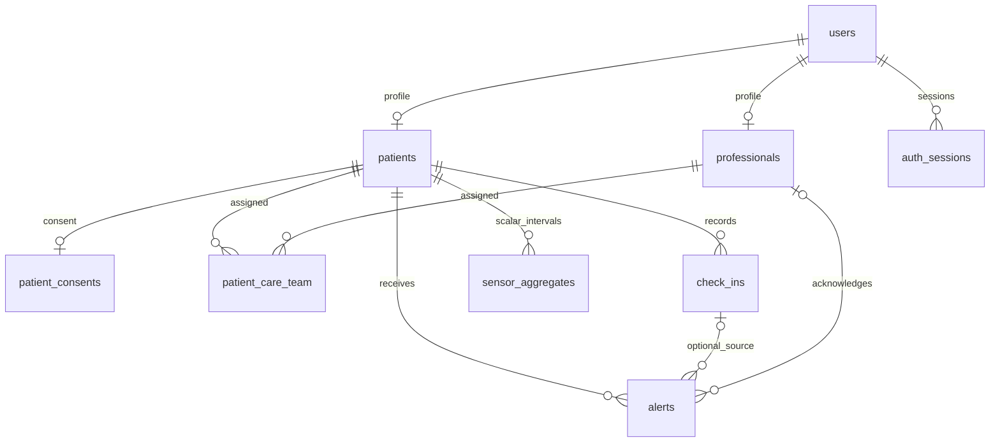

# Initial Hiillos schema V2

Revision `20261114_0001`. Nine application tables plus Alembic's bookkeeping
`alembic_version` table. Frozen explicit migration; it does not import evolving ORM
models when executed. No business rules or reference data are stored by migration.

## Tables and API mapping

| Table | Fields / source |
|---|---|
| users | UUID id, role patient/doctor, is_synthetic, created_at. DEMO_USERS identities; no password or personal seed data. |
| patients | id is both PK and FK to users.id; display_name, language, time_zone, companion_species/name, theme, large_text, reduce_motion, haptics, created_at. Nested API companion/settings map to these columns. |
| professionals | id is PK/FK to users.id. No invented qualifications or contact data. |
| patient_care_team | Composite PK patient_id/professional_id. Reconstructs careTeamIds. |
| patient_consents | patient_id PK/FK; motion, touch_pattern, approximate_location, vibration required explicitly; care_team_after_silence and wearable default false; updated_at nullable, matching initial state. No grant is implied. |
| auth_sessions | UUID id, user_id, 32-byte SHA-256 token_hash (unique), created_at, nullable expires_at/revoked_at. No plaintext token column. |
| check_ins | UUID id, patient_id, date, created_at, mood, kind (full/chat/journal, default full), nullable energy/anxiety/sleep_hours/note, four nullable reaction aggregate columns, self_harm_thoughts. |
| alerts | UUID id, patient_id, nullable check_in_id, patient_display_name snapshot, type, severity, reasons JSONB, created_at, nullable acknowledged_at/by. |
| sensor_aggregates | UUID id, patient_id, sensor_type, period_start/end, value, unit, source, created_at/updated_at. |

## Integrity and nullable fields

All instants use TIMESTAMP WITH TIME ZONE; local check-in date uses DATE. UUIDs
are generated in the application (no PostgreSQL extension needed). All foreign
keys use RESTRICT on delete. No automatic cascade deletion of profiles or alerts.

- `uq_check_ins_ordinary_patient_date` is UNIQUE(patient_id, date) WHERE
  self_harm_thoughts = false. Exactly one ordinary entry is allowed per day, while
  multiple positive safety reports are allowed. It is not an unrestricted UNIQUE.
- `kind` is full/chat/journal (default full); energy/anxiety are nullable with bounds
  1–5 only when present. No missing measurement is filled with a midpoint or zero.
- Check-in id and created_at have no onupdate/server_onupdate behavior. A future PUT
  repository must update the existing ordinary row, not delete/reinsert it. SQL
  indexes do not enforce safety-history immutability; that remains a service rule.
- UNIQUE(patient_id, id) supplies the candidate key for the composite alert FK.
- alerts(patient_id, check_in_id) references check_ins(patient_id, id). An alert
  cannot reference another patient's check-in. check_in_id may be NULL, while a
  separate patient FK still requires an existing patient.
- An acknowledged_by value, if present, references a registered professional.
  It does not itself prove authorization; assignment must be checked in the service.
- Mood is 1–5; energy and anxiety are 1–5 when present; optional sleep is 0–24; optional note is at
  most 1000 characters, exactly matching CheckInCreate.
- Reaction is either four NULLs (not performed), or all four values. Rounds >=1
  and accuracy 0–1. No default zero and no invented result. mean_ms/sd_ms have no
  additional bounds because the current Pydantic contract defines none.
- Language, companion species/name, settings, alert type/severity match the
  current backend enums and constraints. Backend uses human, not mobile's person.
- display_name and time_zone remain text without extra length/zone constraints:
  Patient has none; PATCH-specific validation remains in PatientUpdate.
- Reasons are an ordered JSONB array of {key, text, optional weight}. PostgreSQL
  checks array type; the existing Reason Pydantic model remains responsible for
  each object's shape at the service/repository boundary. No translated text is
  silently regenerated or sorted. No numeric clinical thresholds are stored here.

## Indexes

Primary and unique constraints create their own indexes. The ordinary patient/date
index is partial; a separate non-unique patient/date/created_at index covers all
records, including repeated safety reports. Sessions index user/created_at and expires_at. Care-team index reverses the
composite PK for queries by professional. Alerts index patient/created_at,
patient/check_in_id, acknowledged_by, and created_at for unacknowledged alerts.
No speculative JSONB GIN or full-text index is introduced.

## Scope and privacy

This revision does not create PHQ, conversation, GPS, trusted-contact,
free-form clinical-review or treatment tables. Reaction data are aggregates only.
The optional note column preserves the existing HTTP contract, but wiring actual
cloud note persistence remains blocked on the team's explicit privacy decision.
No real patient information or synthetic persona histories are inserted.

## Sensor aggregates: exact current contract

Target: Owais `backend/app/schemas/sensors.py` at f5d5698.

| Column | Type / meaning |
|---|---|
| id | UUID PK, generated by the application for a new row |
| patient_id | UUID FK to patients.id, delete RESTRICT |
| sensor_type | Text: activity, steps, outdoor_daylight, screen_engagement, sleep, resting_heart_rate |
| period_start / period_end | TIMESTAMP WITH TIME ZONE; end strictly after start |
| value | DOUBLE PRECISION; nonnegative; no invented precision or daily total |
| unit | Text: minutes, steps, index_0_1, count, hours, bpm |
| source | Text: phone (default), wearable, manual, synthetic |
| created_at / updated_at | TIMESTAMP WITH TIME ZONE, initially now() |

`unit=index_0_1` requires value <=1. Sleep requires hours and value <=24.
Resting heart rate requires bpm and value 20–250. These are existing API validation
bounds, not newly chosen clinical alert thresholds. Other sensor types retain the
API's currently broader unit combinations; no extra type/unit mapping is imposed.
No HRV type or ms unit is accepted. source=synthetic is provenance, not consent.

UNIQUE(patient_id, sensor_type, period_start) matches Owais's memory upsert key.
It deliberately does NOT include source: a changed source still replaces the same
logical aggregate. The unique index supports per-metric histories; the additional
patient_id/period_start index supports all-metric time ranges. No second daily table.

Future repository: upsert period_end/value/unit/source, explicitly set updated_at,
and preserve id/created_at. Validate all 1–200 batch items and consents BEFORE any
write; commit all items together or none. These behaviors are not wired here.

TIMESTAMPTZ does not remember the original timezone label. API AwareDatetime must
continue to reject naive timestamps; database storage alone cannot prove the caller
provided an offset. Local-night attribution and timezone history need an agreed
contract before syncing HRV, wake times or wearable-derived outcomes.
